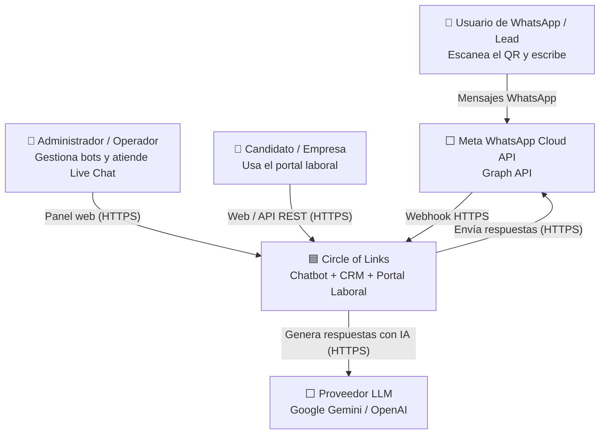
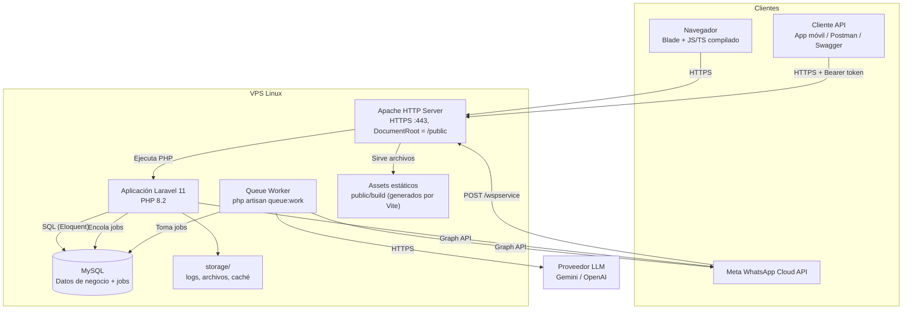
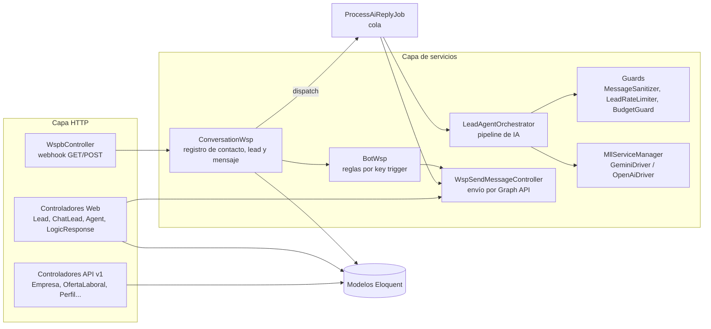
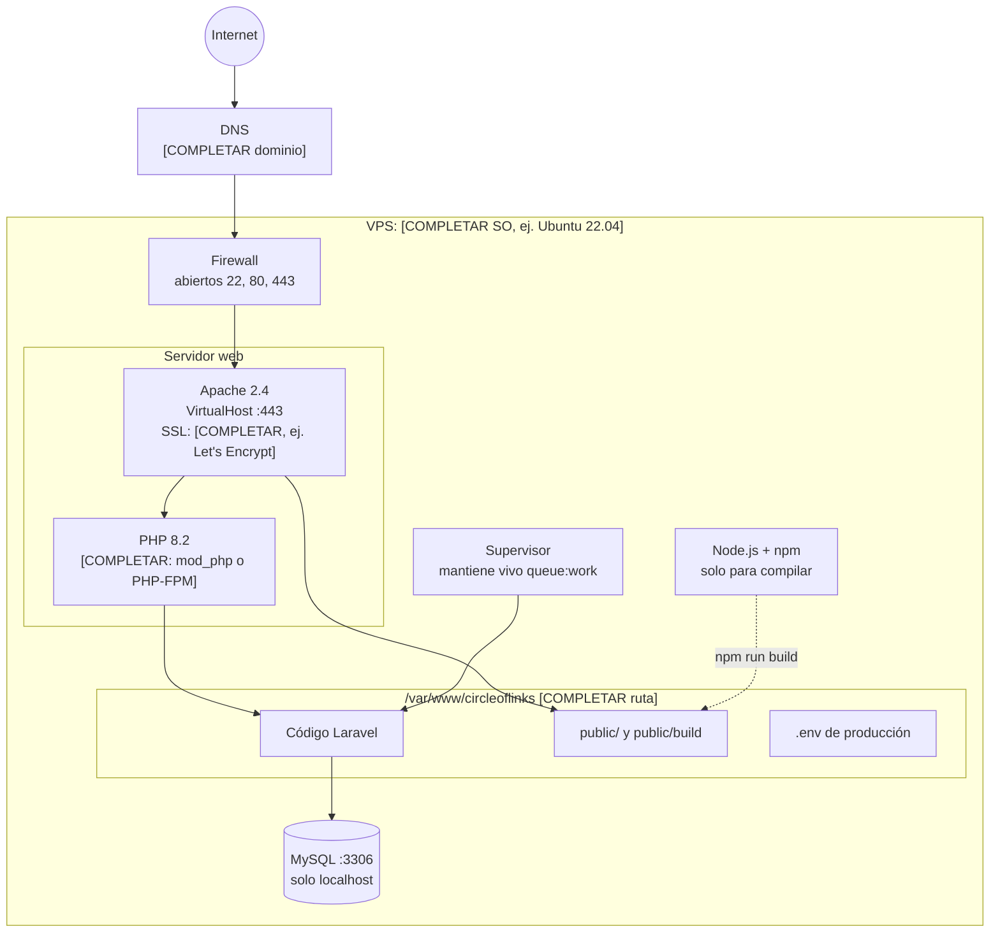
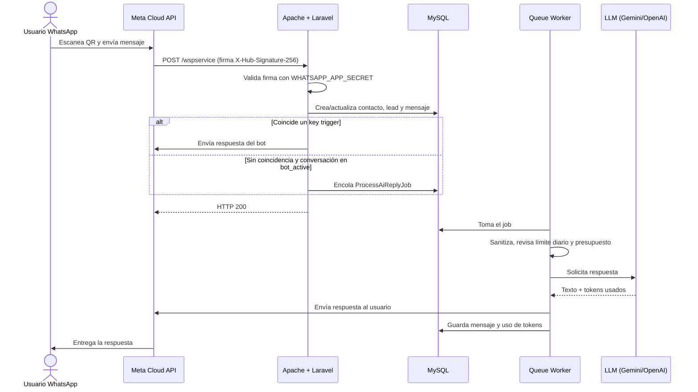
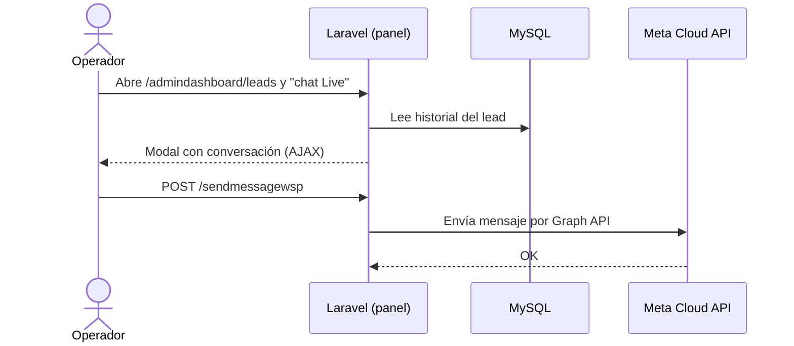

# Documento de Arquitectura del Sistema
## Circle of Links: Chatbot de WhatsApp y Portal Laboral

| Campo | Valor |
| :--- | :--- |
| Versión del documento | 1.0 |
| Fecha | Octubre 2026 |
| Autor(es) | [COMPLETAR] |
| Estado | Borrador |

> **Cómo leer este documento.** Sigue el **modelo C4**: se parte de la vista más general (el sistema y su entorno) y se baja de nivel hasta los componentes internos. Después se describe **dónde corre** el sistema (vista de despliegue), **cómo se mueve la información** (flujos) y **por qué** se tomaron las decisiones principales.
> Lo marcado con **[COMPLETAR]** depende de la configuración real de la VPS y debe confirmarse.

---

## 1. Introducción y alcance

### 1.1 Propósito
Este documento describe la arquitectura técnica de **Circle of Links**: sus componentes, cómo se comunican, la infraestructura donde se ejecutan y las decisiones de diseño. Está dirigido a desarrolladores, a quien administre el servidor y a evaluadores del proyecto.

### 1.2 Alcance del sistema
- **Chatbot y CRM de WhatsApp:** recibe mensajes por la WhatsApp Cloud API, responde con reglas (*triggers*) o con IA, registra *leads* y permite atención humana (*Live Chat*).
- **Portal laboral:** empresas, ofertas de empleo, perfiles profesionales, postulaciones y red de contactos, expuestos por una API REST.

### 1.3 Requisitos de calidad que guían la arquitectura

| Atributo | Requisito |
| :--- | :--- |
| Disponibilidad | El webhook de WhatsApp debe estar accesible por HTTPS 24/7 |
| Rendimiento | El webhook debe responder a Meta rápido (HTTP 200); el trabajo pesado (IA) va a una cola |
| Seguridad | Validación de firma de Meta, autenticación por sesión y token, secretos fuera del código |
| Costo | Infraestructura de un solo servidor (VPS) y uso de conversaciones iniciadas por el usuario en WhatsApp |
| Mantenibilidad | Framework estándar (Laravel), capas separadas (controladores, servicios, *jobs*) |

---

## 2. Restricciones técnicas

| Restricción | Detalle |
| :--- | :--- |
| Infraestructura | Una VPS Linux: [COMPLETAR proveedor, plan, CPU/RAM, sistema operativo] |
| Servidor web | Apache HTTP Server [COMPLETAR versión] |
| Lenguaje y framework | PHP 8.2+ con Laravel 11 |
| Base de datos | MySQL [COMPLETAR versión], en el mismo servidor |
| Frontend | Assets compilados con Node.js + Vite (TypeScript, SCSS, Tailwind, Bootstrap) |
| Integraciones | Meta WhatsApp Cloud API (Graph API), proveedores LLM (Google Gemini / OpenAI) |

---

## 3. Vista de contexto (C4, nivel 1)

Muestra el sistema como una caja negra, con sus usuarios y los sistemas externos con los que se comunica.



---

## 4. Vista de contenedores (C4, nivel 2)

Un *contenedor* es una pieza que se ejecuta o almacena datos por separado (no confundir con Docker).



| Contenedor | Tecnología | Responsabilidad |
| :--- | :--- | :--- |
| Apache | Apache 2.4 + `mod_rewrite` + SSL | Termina HTTPS, sirve los assets y pasa las peticiones a Laravel |
| Aplicación Laravel | PHP 8.2, Laravel 11 | Rutas web y API, lógica de negocio, webhook de WhatsApp |
| Queue Worker | `php artisan queue:work` | Procesa en segundo plano las respuestas con IA (`ProcessAiReplyJob`) |
| Base de datos | MySQL | Persistencia de usuarios, leads, conversaciones, mensajes, ofertas, uso de IA |
| Assets estáticos | Vite → `public/build` | CSS y JS ya compilados que descarga el navegador |
| Almacenamiento | Carpeta `storage/` | Logs, caché en archivos, sesiones y archivos subidos |

> **Sobre Node.js:** en esta arquitectura Node.js **no** es un servidor en ejecución. Solo se usa para **compilar** el frontend (`npm run build`). El resultado son archivos estáticos que sirve Apache. No hace falta tener `npm run dev` corriendo en producción.

---

## 5. Vista de componentes del backend (C4, nivel 3)



| Carpeta | Contenido |
| :--- | :--- |
| `app/Http/Controllers` | Controladores web, API y del webhook de WhatsApp |
| `app/Services/WhatsappApi` | Procesamiento de conversaciones, bot por reglas, perfil de WhatsApp |
| `app/Services/AI` | Orquestador de IA, drivers de LLM, prompts, guards de seguridad y costo |
| `app/Jobs` | Trabajos en cola (respuesta con IA) |
| `app/Models` | Entidades Eloquent |
| `app/Policies` | Reglas de autorización |
| `routes/web.php` / `routes/api.php` | Rutas del panel y de la API REST |
| `resources/views` / `resources/js` | Vistas Blade y código TypeScript |

---

## 6. Vista de despliegue (infraestructura en la VPS)



### 6.1 Inventario del servidor

| Elemento | Valor |
| :--- | :--- |
| Proveedor y plan de la VPS | [COMPLETAR] |
| Sistema operativo | [COMPLETAR] |
| CPU / RAM / Disco | [COMPLETAR] |
| Dominio | [COMPLETAR] |
| Certificado SSL | [COMPLETAR] |
| Versión de Apache | [COMPLETAR] (`apache2 -v`) |
| Versión de PHP | [COMPLETAR] (`php -v`) |
| Versión de MySQL | [COMPLETAR] (`mysql --version`) |
| Versión de Node.js | [COMPLETAR] (`node -v`) |
| Ruta del proyecto | [COMPLETAR] |
| Usuario del sistema que ejecuta la app | [COMPLETAR, ej. `www-data`] |

### 6.2 Configuración de Apache (referencia)

```apache
<VirtualHost *:443>
    ServerName [tu-dominio]
    DocumentRoot /var/www/circleoflinks/public

    <Directory /var/www/circleoflinks/public>
        AllowOverride All
        Require all granted
    </Directory>

    SSLEngine on
    SSLCertificateFile    /etc/letsencrypt/live/[tu-dominio]/fullchain.pem
    SSLCertificateKeyFile /etc/letsencrypt/live/[tu-dominio]/privkey.pem

    ErrorLog  ${APACHE_LOG_DIR}/circleoflinks_error.log
    CustomLog ${APACHE_LOG_DIR}/circleoflinks_access.log combined
</VirtualHost>
```

> El `DocumentRoot` **debe** apuntar a `public/`. Si apunta a la raíz del proyecto, el archivo `.env` y el código fuente quedan expuestos.

### 6.3 Worker de colas (Supervisor)

La respuesta con IA (`ProcessAiReplyJob`) es un *job* en cola. Para que se ejecute en segundo plano se necesita:

1. En `.env`: `QUEUE_CONNECTION=database` (si no se define, el proyecto usa `sync` y la IA se ejecuta dentro de la misma petición del webhook).
2. La tabla de jobs: `php artisan queue:table` (si no existe) y `php artisan migrate`.
3. Un proceso que la consuma, mantenido por Supervisor:

```ini
[program:circleoflinks-worker]
command=php /var/www/circleoflinks/artisan queue:work --tries=2 --timeout=60
autostart=true
autorestart=true
user=www-data
numprocs=1
redirect_stderr=true
stdout_logfile=/var/www/circleoflinks/storage/logs/worker.log
```

---

## 7. Flujos principales

### 7.1 Mensaje entrante de WhatsApp (bot por reglas o IA)



### 7.2 Atención humana (Live Chat)



---

## 8. Seguridad

| Capa | Medida |
| :--- | :--- |
| Transporte | HTTPS obligatorio (Meta exige HTTPS para el webhook) |
| Webhook | Verificación con `WHATSAPP_VERIFY_TOKEN` (GET) y firma `X-Hub-Signature-256` (POST) |
| Panel web | Sesiones con Laravel Breeze, protección CSRF |
| API REST | Tokens con Laravel Sanctum |
| Autorización | Roles y permisos con Spatie Laravel Permission y Policies |
| IA | Sanitización, detección de *prompt injection*, límite diario por lead y control de presupuesto |
| Base de datos | MySQL escuchando solo en `127.0.0.1`, usuario propio con permisos limitados al esquema |
| Secretos | Solo en `.env` del servidor, fuera de Git y fuera de `public/` |
| Producción | `APP_ENV=production`, `APP_DEBUG=false` |

---

## 9. Proceso de despliegue

```bash
# 1. Obtener el código
cd /var/www/circleoflinks
git pull origin main

# 2. Dependencias backend (sin paquetes de desarrollo)
composer install --no-dev --optimize-autoloader

# 3. Compilar el frontend
npm ci
npm run build

# 4. Base de datos
php artisan migrate --force

# 5. Optimizar Laravel
php artisan config:cache
php artisan route:cache
php artisan view:cache

# 6. Reiniciar el worker para que tome el código nuevo
php artisan queue:restart

# 7. Permisos
chown -R www-data:www-data storage bootstrap/cache
```

---

## 10. Operación: respaldos, logs y monitoreo

| Tema | Práctica |
| :--- | :--- |
| Respaldo de BD | `mysqldump` diario por cron, guardado fuera de la VPS [COMPLETAR destino] |
| Logs de la app | `storage/logs/laravel.log` |
| Logs del worker | `storage/logs/worker.log` |
| Logs de Apache | `/var/log/apache2/` |
| Uso y costo de IA | Tabla `ai_usage_logs` |
| Monitoreo | [COMPLETAR, ej. UptimeRobot sobre la URL pública] |

---

## 11. Decisiones de arquitectura (ADR resumidos)

| # | Decisión | Motivo | Consecuencia |
| :--- | :--- | :--- | :--- |
| ADR-01 | Monolito Laravel en una VPS | Bajo costo, simplicidad, un solo equipo | Escala vertical; un solo punto de falla |
| ADR-02 | Apache + MySQL en el mismo servidor | Stack conocido y documentado | Menor latencia; compiten por recursos |
| ADR-03 | Frontend con Blade + Vite (sin SPA) | Menos complejidad, SEO y render en servidor | Node solo en tiempo de compilación |
| ADR-04 | Respuestas de IA en cola | El webhook de Meta debe contestar rápido | Requiere worker supervisado |
| ADR-05 | Drivers intercambiables de LLM | Evitar depender de un solo proveedor | Configuración con `AI_DEFAULT_PROVIDER` |
| ADR-06 | Captación por QR (conversación iniciada por el usuario) | Evitar costos de plantillas salientes | Respuestas libres dentro de la ventana de 24 h |

---

## 12. Riesgos y mejoras futuras

| Riesgo | Mitigación propuesta |
| :--- | :--- |
| Caída de la VPS deja sin webhook | Monitoreo y respaldos; Meta reintenta webhooks por un tiempo limitado |
| Worker detenido, la IA no responde | Supervisor con `autorestart` y alerta sobre `worker.log` |
| Crecimiento del tráfico | Pasar caché y colas a Redis; separar MySQL en otro servidor |
| Versión fija de Graph API (v19.0) en el envío | Centralizar la versión en configuración y actualizarla antes de que Meta la deprecie |
