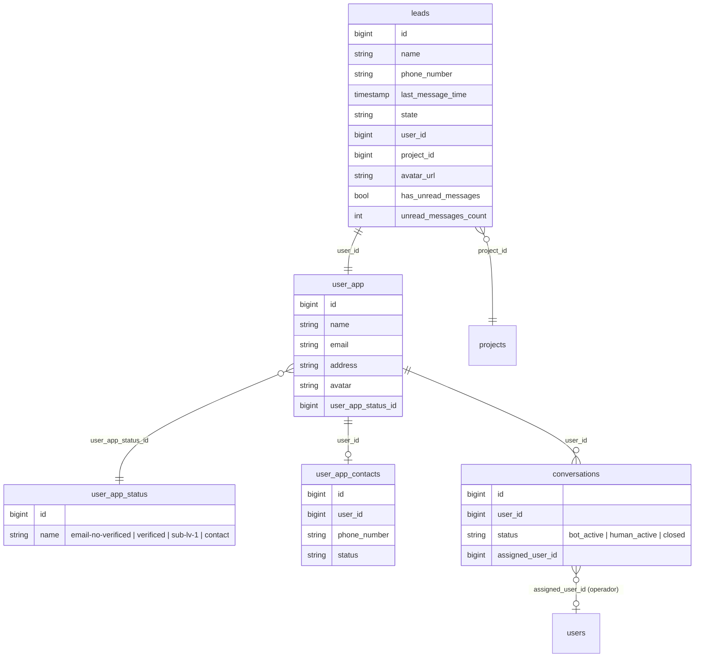
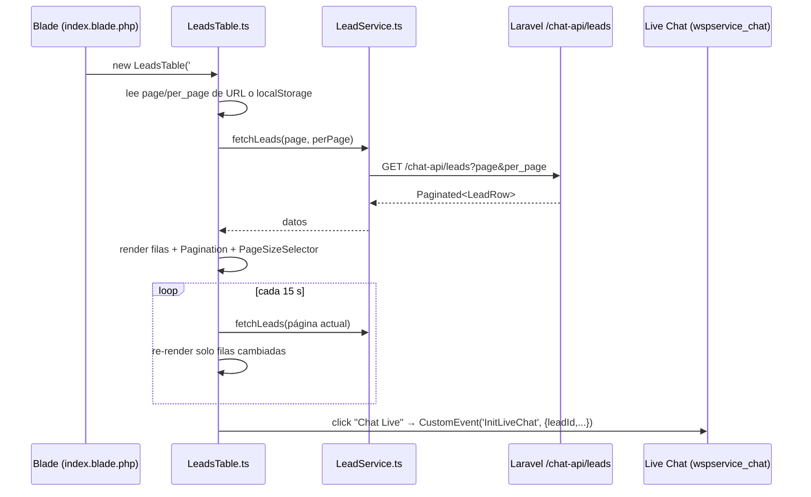

# Componente `LeadsTable` (TypeScript) — Documentación y Propuesta de Diseño

> **Estado:** Propuesta (pendiente de aprobación antes de codificar)
> **Vista afectada:** `resources/views/whatsapp_service/leads/index.blade.php`
> **Ruta:** `GET /admindashboard/leads` → `LeadController@index`
> **Mockup visual:** [`docs/mockups/leads-table-mockup.html`](./mockups/leads-table-mockup.html) (abrir en el navegador)

---

## 1. Objetivo

Reemplazar la tabla actual de Leads (renderizada 100% en Blade, sin paginación y con columnas vacías) por un **componente de vista en TypeScript** que muestre en una sola fila:

| Columna | Qué responde |
| :--- | :--- |
| **1. Lead** | ¿Quién me escribió por WhatsApp? |
| **2. Contacto** | ¿Este lead ya es un contacto dentro de la plataforma? ¿Con qué datos? |
| **3. Estado** | ¿Qué está pasando con la conversación? **¿Pide ser atendido por un humano?** |

Además: selector de **5 / 10 registros por página** y **botones de paginación** en la parte inferior.

---

## 2. Análisis del estado actual

### 2.1. Cómo funciona hoy

```text
LeadController@index
  └─ Lead::whereIn('project_id', $projectIds)->latest()->get()   ← trae TODOS los leads
       └─ index.blade.php
            ├─ @foreach($Leads)  → 1 <tr> por lead
            │    ├─ <th> #        → vacío ($count se calcula pero no se imprime)
            │    ├─ <th> Leads    → card con avatar, nombre, badge no leídos, teléfono, botón "Chat Live"
            │    ├─ <th> Contacto → vacío
            │    └─ <th> Handle   → vacío
            ├─ Modal #staticBackdrop → @include('components.chat-leads')
            └─ <script> inline → dispara CustomEvent('InitLiveChat') / ('DestroyLiveChat')

app.ts
  └─ si existe #leads-list-container → new LeadUnreadStatus()  (polling cada 15 s a /chat-api/unread-status)
```

### 2.2. Problemas detectados

| # | Problema | Impacto |
| :--- | :--- | :--- |
| P1 | `->get()` trae todos los leads sin paginar | Lento a medida que crecen los leads |
| P2 | Columnas `Contacto` y `Handle` vacías; `#` sin valor | La tabla no aporta la información de negocio |
| P3 | Se usan `<th>` en el cuerpo en lugar de `<td>` | Semántica / accesibilidad incorrecta |
| P4 | No se muestra el estado de la conversación (`bot_active` / `human_active` / `closed`) aunque ya existe en BD | El operador no sabe qué leads esperan a un humano |
| P5 | Script inline en la vista | Difícil de mantener/tipar; se moverá a TS |
| P6 | `UserApp::contact()` referencia `UserAppContact::class` pero el archivo es `userAppContact.php` | Funciona en Windows, **puede fallar en Linux** (autoload sensible a mayúsculas) |
| P7 | `ApiChatController@getConversation` y `@takeControl` no validan que el lead pertenezca a los proyectos del usuario | Riesgo IDOR: un usuario autenticado podría leer/tomar chats ajenos por ID |

> P6 y P7 no son parte estricta de este componente, pero conviene resolverlos en la misma iteración (ver §9).

---

## 3. Modelo de datos involucrado



**Claves de negocio:**

- Cada **Lead** está ligado 1:1 a un `user_app` (se crea automáticamente al llegar un WhatsApp, CU-02).
- Un lead **"pasa a contacto"** cuando su `user_app` tiene `user_app_status.name = 'contact'` (y opcionalmente datos completados: email, dirección, etc.).
- El estado de atención vive en la **última conversación** del `user_app` (`conversations.status` + `assigned_user_id`).
- La IA activa el handover en `ProcessAiReplyJob` → `status = 'human_active'` **sin** `assigned_user_id`. Eso significa: *"el lead pidió un humano y nadie lo ha tomado todavía"*.

---

## 4. Especificación de columnas

### 4.1. Columna 1 — Lead

| Elemento | Fuente | Notas |
| :--- | :--- | :--- |
| Avatar | `leads.avatar_url` → fallback `ui-avatars.com` | Mantener `onerror` fallback actual |
| Badge no leídos | `unread_messages_count` / `has_unread_messages` | `99+` si supera 99. Se actualiza por polling |
| Nombre | `leads.name` | Ícono WhatsApp al lado |
| Teléfono | `leads.phone_number` | Formato `+56 9 1234 5678` |
| Último mensaje | `leads.last_message_time` | Formato relativo: "hace 5 min" (tooltip con fecha exacta) |
| Botón **Chat Live** | `lead.id` | Dispara el mismo `CustomEvent('InitLiveChat')` que hoy |

### 4.2. Columna 2 — Contacto

Dos estados visuales:

**a) El lead YA es contacto** (`user_app_status = 'contact'`):

| Elemento | Fuente |
| :--- | :--- |
| Badge verde "Contacto" | `user_app_status.name` |
| Nombre en plataforma | `user_app.name` |
| Email | `user_app.email` (o "—") |
| Teléfono de contacto | `user_app_contacts.phone_number` |
| Dirección | `user_app.address` (opcional, truncada) |
| Acción "Ver ficha" | Link a `/admindashboard/contacts` (o futura ficha individual) |

**b) El lead AÚN NO es contacto:**

- Texto atenuado: *"Aún no es contacto"* + estado actual del `user_app` (ej. `email-no-verificed`).
- Botón secundario **"Convertir a contacto"** → *Fase 2* (abre modal con nombre/email/dirección y llama a `POST /chat-api/leads/{id}/convert-to-contact`).

### 4.3. Columna 3 — Estado / Mensajes de estado

El estado se **deriva** en un único valor (`LeadAttentionStatus`) a partir de la última conversación:

| Prioridad | Estado derivado | Condición | Color / Ícono | Mensaje mostrado |
| :---: | :--- | :--- | :--- | :--- |
| 1 | `WAITING_HUMAN` | `status = human_active` **y** `assigned_user_id IS NULL` | 🔴 Rojo, pulso animado, `bi-person-raised-hand` | **"Solicita atención humana"** · "esperando hace 12 min" |
| 2 | `HUMAN_ACTIVE` | `status = human_active` **y** `assigned_user_id` presente | 🟠 Naranja, `bi-headset` | "Atendido por **{operador}**" |
| 3 | `BOT_ACTIVE` | `status = bot_active` | 🟢 Verde, `bi-robot` | "Atendido por el bot" |
| 4 | `CLOSED` | `status = closed` | ⚪ Gris, `bi-check2-circle` | "Conversación cerrada" |
| 5 | `NO_CONVERSATION` | No hay conversación | ⚪ Gris claro, `bi-dash-circle` | "Sin conversación" |

Debajo del badge se muestra un **preview del último mensaje** (máx. 60 caracteres, truncado) para dar contexto.

**Acciones rápidas en la columna:**

- `WAITING_HUMAN` → botón **"Tomar chat"** (llama a `POST /chat-api/take-control` y abre el Live Chat).
- `HUMAN_ACTIVE` (asignado a mí) → botón **"Devolver al bot"** (`action: bot_active`).

> El tiempo de espera ("hace 12 min") se calcula con `conversations.updated_at` en la Fase 1. Si se requiere exactitud, en Fase 2 se puede agregar `conversations.handover_requested_at`.

---

## 5. Paginación y tamaño de página

### 5.1. Comportamiento

- **Selector** "Mostrar [5 | 10] registros" arriba a la derecha de la tabla. **Default: 10.**
- **Pie de tabla:** texto "Mostrando 1–10 de 47 leads" a la izquierda; botones a la derecha:
  `« Anterior | 1 | 2 | 3 | … | 5 | Siguiente »`
- Al cambiar el tamaño de página → volver a la página 1.
- El estado (`page`, `per_page`) se refleja en la URL (`?page=2&per_page=5`) para que **F5 y "Atrás" mantengan la vista**, y `per_page` se recuerda en `localStorage`.

### 5.2. Server-side (recomendado) vs client-side

| | Server-side ✅ | Client-side |
| :--- | :--- | :--- |
| Escala con miles de leads | Sí | No (descarga todo) |
| Polling liviano | Sí (solo la página visible) | No |
| Complejidad | Requiere endpoint JSON | Más simple |

**Decisión propuesta:** paginación **server-side** con `->paginate($perPage)` de Laravel.

### 5.3. Orden por defecto

Los leads que **solicitan humano** van **primero**, luego por último mensaje:

```text
1. WAITING_HUMAN   (más antiguos primero → los que más esperan)
2. HUMAN_ACTIVE
3. resto, por last_message_time DESC
```

---

## 6. Contrato de API (nuevo endpoint)

### `GET /chat-api/leads?page=1&per_page=10`

- **Middleware:** `auth` (dentro del grupo `chat-api` existente).
- **Validación:** `per_page ∈ {5, 10}`, `page ≥ 1`.
- **Autorización:** solo leads de los `project_id` de las compañías del usuario autenticado (misma lógica que `LeadController@index`).

**Respuesta (forma estándar del paginador de Laravel, recortada):**

```json
{
  "data": [
    {
      "id": 12,
      "name": "María González",
      "phone_number": "56912345678",
      "avatar_url": "https://...",
      "last_message_time": "2026-10-22T19:48:10-03:00",
      "unread_messages_count": 3,
      "has_unread_messages": true,
      "contact": {
        "is_contact": true,
        "user_app_id": 40,
        "name": "María González",
        "email": "maria@correo.cl",
        "address": "Av. Siempre Viva 742",
        "phone_number": "56912345678",
        "status_name": "contact"
      },
      "attention": {
        "conversation_id": 88,
        "status": "WAITING_HUMAN",
        "raw_status": "human_active",
        "assigned_user": null,
        "since": "2026-10-22T19:40:00-03:00",
        "last_message_preview": "Quiero hablar con una persona por favor"
      }
    }
  ],
  "meta": {
    "current_page": 1,
    "per_page": 10,
    "last_page": 5,
    "total": 47,
    "from": 1,
    "to": 10
  }
}
```

> El campo `attention.status` lo calcula el **backend** (un solo lugar de verdad). El frontend solo lo pinta.

### Cambios backend necesarios (referencia)

```php
// Lead.php — nueva relación a la última conversación del user_app
public function latestConversation()
{
    return $this->hasOne(Conversation::class, 'user_id', 'user_id')->latestOfMany();
}
```

```php
// Consulta (en un LeadTableController o en LeadController@data)
Lead::query()
    ->whereIn('project_id', $projectIds)
    ->with([
        'user.StatusUserApp',
        'user.contact',
        'latestConversation.assignedUser:id,name',
        'latestConversation.latestMessage',   // relación nueva, opcional
    ])
    ->paginate($perPage);
// + transformación a JSON vía API Resource (LeadRowResource)
```

Endpoints existentes que se reutilizan:

| Acción | Endpoint |
| :--- | :--- |
| Badges de no leídos (polling) | `GET /chat-api/unread-status` |
| Abrir chat | `GET /chat-api/conversation/lead/{leadId}` |
| Tomar chat / devolver al bot | `POST /chat-api/take-control` |

---

## 7. Arquitectura del componente TypeScript

Sigue la estructura definida en [`ESTRUCTURA_FRONTEND.md`](../ESTRUCTURA_FRONTEND.md).

```text
resources/js/
├── types/
│   └── LeadTable.ts              # LeadRow, LeadContact, LeadAttention, Paginated<T>, LeadAttentionStatus
├── services/
│   └── LeadService.ts            # fetchLeads(page, perPage), takeControl(convId, action)
├── utils/
│   ├── leadStatus.ts             # mapa estado → { label, color, icon }
│   └── formatters.ts             # timeAgo(), formatPhone(), truncate(), escapeHtml()
└── components/
    ├── leads/
    │   ├── LeadsTable.ts         # Orquestador: estado, render, polling, eventos
    │   ├── LeadCell.ts           # Render columna 1
    │   ├── ContactCell.ts        # Render columna 2
    │   └── StatusCell.ts         # Render columna 3
    └── ui/
        ├── Pagination.ts         # Botones « 1 2 … n » reutilizable
        └── PageSizeSelector.ts   # <select> 5 / 10 reutilizable
```

### 7.1. Tipos principales

```ts
export type LeadAttentionStatus =
  | 'WAITING_HUMAN' | 'HUMAN_ACTIVE' | 'BOT_ACTIVE' | 'CLOSED' | 'NO_CONVERSATION';

export interface LeadContact {
  is_contact: boolean;
  user_app_id: number | null;
  name: string | null;
  email: string | null;
  address: string | null;
  phone_number: string | null;
  status_name: string | null;
}

export interface LeadAttention {
  conversation_id: number | null;
  status: LeadAttentionStatus;
  raw_status: 'bot_active' | 'human_active' | 'closed' | null;
  assigned_user: { id: number; name: string } | null;
  since: string | null;
  last_message_preview: string | null;
}

export interface LeadRow {
  id: number;
  name: string;
  phone_number: string;
  avatar_url: string | null;
  last_message_time: string | null;
  unread_messages_count: number;
  has_unread_messages: boolean;
  contact: LeadContact;
  attention: LeadAttention;
}

export interface PaginationMeta {
  current_page: number;
  per_page: 5 | 10;
  last_page: number;
  total: number;
  from: number | null;
  to: number | null;
}

export interface Paginated<T> { data: T[]; meta: PaginationMeta; }
```

### 7.2. Ciclo de vida



### 7.3. Integración con lo existente

- **Blade** queda mínima: un contenedor `<div id="leads-table-root" data-endpoint="/chat-api/leads"></div>` + el modal actual del chat.
- **`LeadUnreadStatus`**: se absorbe dentro del polling de `LeadsTable` (un solo polling en lugar de dos). Se mantiene la clase para otras vistas si la usan.
- **Live Chat**: no se modifica; `LeadsTable` emite el mismo `CustomEvent('InitLiveChat')` con `{ leadId, name, phone, avatar }`.
- **Script inline** de la vista se mueve a `LeadsTable.ts`.
- Se inicializa en `app.ts` igual que hoy (`if (document.getElementById('leads-table-root')) new LeadsTable(...)`).

### 7.4. Estados de UI

| Estado | Qué se ve |
| :--- | :--- |
| Cargando (primera vez) | 5–10 filas *skeleton* (placeholders de Bootstrap) |
| Refrescando (polling) | Sin parpadeo; actualización silenciosa |
| Vacío | Ícono WhatsApp + "Aún no tienes leads. Cuando alguien escriba a tu número aparecerá aquí." |
| Error | Alerta con botón "Reintentar" (usar `AlertComponent` existente) |

### 7.5. Responsive

- **≥ 992 px:** tabla de 3 columnas.
- **< 992 px:** cada fila se transforma en una **tarjeta apilada** (Lead arriba, Contacto y Estado debajo), manteniendo selector y paginación.

---

## 8. Seguridad

| Regla | Detalle |
| :--- | :--- |
| **XSS** | `name`, `last_message_preview`, etc. vienen de WhatsApp (**entrada no confiable**). Renderizar con `textContent` o `escapeHtml()`. **Nunca** interpolar datos crudos en `innerHTML`. |
| **Autorización** | El endpoint `/chat-api/leads` filtra por proyectos del usuario autenticado. |
| **Validación** | `per_page` restringido a `5` o `10` en el backend (evita pedir 100 000 filas). |
| **CSRF** | Las acciones POST (`take-control`) usan el token CSRF vía `ApiClient`. |

---

## 9. Plan de implementación propuesto

| Fase | Alcance |
| :--- | :--- |
| **Fase 1 — Lectura** | Endpoint `GET /chat-api/leads` + `LeadRowResource` · relación `latestConversation` · tipos TS · `LeadService` · `LeadsTable` con 3 columnas · selector 5/10 · paginación · polling unificado · responsive |
| **Fase 2 — Acciones** | Botón "Tomar chat" / "Devolver al bot" desde la tabla · "Convertir a contacto" (modal + endpoint) · campo `handover_requested_at` |
| **Fase 3 — Extras (opcional)** | Barra resumen ("3 esperando humano") · filtro "Solo los que piden humano" · búsqueda por nombre/teléfono · notificación sonora cuando entra un `WAITING_HUMAN` |
| **Deuda técnica** | Renombrar `userAppContact.php` → `UserAppContact.php` (P6) · validar ownership en `getConversation`/`takeControl` (P7) |

---

## 10. Preguntas abiertas

1. **¿Qué define "pasar a contacto"?** Se asumió `user_app_status = 'contact'`. ¿Es correcto o se usa otro criterio (ej. tener email)?
2. **¿"Convertir a contacto" entra en la Fase 1** o se deja para después?
3. **¿Se agregan 25 registros** como tercera opción del selector, o solo 5 y 10?
4. **¿El orden "los que piden humano primero"** te parece bien, o prefieres orden puro por último mensaje?
5. **¿Botón "Tomar chat" directamente en la tabla** (Fase 2) o solo dentro del Live Chat?
